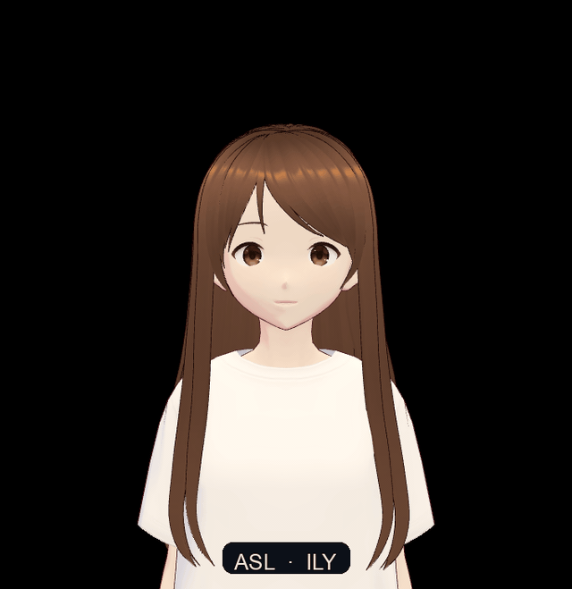
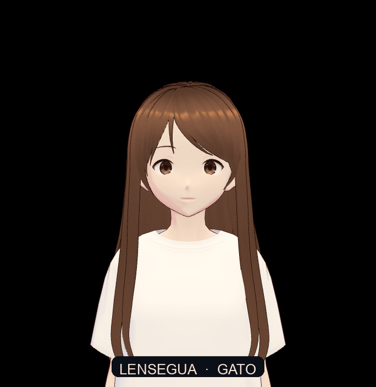

# Marionet

Marionet turns sign language signs into small animation files that play on any [VRM](https://vrm.dev/en/) avatar in the browser.

You describe a sign the way a linguist would: handshape, where the hand is, which way the palm faces and how it moves, plus head, body and face if they matter. A compiler turns that description into bone rotations, and a three.js player performs it on whichever VRM is loaded, including one you drop in yourself.





## What's here

- **28 finished signs**, baked to `clips/` and checked by eye on the sample avatar:
  - ASL fingerspelling A–Z, including the movement of J and Z.
  - ASL **ILY**. It's one sign. "I love you" is its English translation, not three signs and not three letters.
  - LENSEGUA **GATO** ("cat"). This is a sketch (F-hand, whisker stroke at the cheek), not an entry from a licensed LENSEGUA dictionary.
- **2,470 ASL-LEX entries that compile** but haven't been reviewed. They use a small set of generic movements, so many look alike.
- **A browser player** to search signs, play them and swap avatars.

## How it works

```
SignDesc (data/signs/*.json)        what the sign is: handshape, location, palm, movement, head/body/face
   │
   │  src/compile.js + src/library.js
   ▼
MarionetClip (clips/*.json)         keyframed rotations per VRM bone, plus face expression weights
   │
   │  src/vrm.js
   ▼
any VRM avatar in the browser
```

- **SignDesc** describes one sign: one entry per lemma. Schema: `schemas/signdesc.v0.schema.json`.
- **The library** (`src/library.js`) is the vocabulary: each named handshape, location, palm orientation and movement as bone rotations. The numbers are fitted on the sample avatar against targets on the body, then checked by eye:
  - each location puts the index fingertip on its point (forehead, eye, nose, cheek, mouth, chin, neck, temple, ear, shoulder) or holds the hand a set distance in front of the body (chest, belly, neutral space);
  - two-handed signs give each hand its own side, and the non-dominant hand waits in front of the body for the dominant hand to act on it;
  - each named palm orientation is fitted per location;
  - `linear`, `arc` and `circle` move the hand along real paths;
  - fingerspelling has its own station, thumbs and paths for J and Z.

  A sign with no orientation (ASL-LEX gives none) uses the location's natural hand.
- **MarionetClip** is the output: per-bone keyframes as rotations relative to an arms-down rest pose. It doesn't depend on any particular avatar. Schema: `schemas/clip.v0.schema.json`.
- **The player** loads a VRM, puts it in the rest pose and applies the clip on top. Clips are fitted on the sample avatar, so the player retargets each one to the avatar it's playing on:
  - **Arms** (`src/body.js`): the first time a sign plays, the player measures about 20 points on this avatar's face and body, the same points the location fits aimed at. For each keyframe it finds the hand point nearest the body on the sample (a fingertip on the chin, the palm in front of the chest) and carries it to the same place on this body, scaled to this face or torso. It then bends this arm to put the hand there, facing the same way, and lifts the hand off the skin wherever another point would sink in.
  - **Thumbs** (`src/hands.js`): rigs build the thumb, and space the knuckles, differently. The clip's thumb joints are found among the sample's fingers, curled as the clip curls them, and placed at the same spots among this avatar's fingers, so a thumb on the index's middle joint stays on it.

  An avatar built like the sample gets the clip exactly as baked. Everything that plays a clip goes through the retargeting: the player, the dictionary videos and the embed (below).

  `scripts/check_reach.mjs` measures it on the sixteen signers in `avatars/out/`. Played as baked, fingertips sank up to 0.8 cm into their faces, and hands stopped up to 7 cm short of the ear, chest and belly. Retargeted, face and shoulder contacts land within about 0.6 cm of where they do on the sample, and the neck and ear within 1 cm. On the men, chest and belly contacts sit 1.1–1.4 cm further out, scaled to their bigger torsos. No contact ends up under the skin.

## Run the player

```sh
npm install
python3 -m http.server 8080
# open http://localhost:8080
```

- Type A–Z to fingerspell, or search the lexicon.
- Drop a `.vrm` file onto the page to change avatar.
- Drop a clip or SignDesc `.json` file to play it.
- Demo loops: `?demo=ily`, `?demo=gato`, or `?demo=1` for both.

## Add or fix a sign

1. Edit the sign in `data/signs/…`, or the vocabulary in `src/library.js`.
2. Bake: `npm run bake` writes `clips/`. `npm run check` fails if `clips/` is out of date.
3. Look at it:
   ```sh
   python3 -m http.server 8765        # in another terminal
   npm run render-clips
   open data/runs/renders/index.html
   ```
   The gallery shows three things:
   - a slow camera orbit around each held handshape, which shows depth such as whether the thumb is over or under the fingers;
   - a front-view video of each moving sign, with the fingertip's path drawn as it goes;
   - still frames.
4. Check for fingers passing through each other: `node scripts/hand_gaps.mjs`, or on other avatars with `--avatars avatars/out/w-white.vrm,…`. To render the gallery on another avatar, set `MARIONET_AVATAR=avatars/out/w-white.vrm`.
   To check that hands land where the location fits aimed on every signer, run `node scripts/check_reach.mjs`, adding `--shots data/runs/reach` for close-ups. If you change where `src/body.js` measures, run `node scripts/measure_body.mjs` to re-measure the sample.
5. If a thumb is in the wrong place, set its target in `scripts/fit_thumbs.mjs`, run it, and paste the row it prints into `THUMB_POSES` in `src/library.js`. For locations, palm orientations and movement paths, `scripts/fit_arm.mjs` does the same job: see its header for the order to run its modes.
6. To spot-check lexicon signs, bake chosen ones elsewhere and render them:
   ```sh
   node scripts/bake_clips.mjs --ids ase/asllex/please,ase/asllex/night --out data/runs/preview
   MARIONET_CLIPS=data/runs/preview node scripts/render_clips.mjs http://127.0.0.1:8765 data/runs/preview-renders
   ```

Rendering drives your installed Chrome through Playwright, needs `ffmpeg`, and downloads the sample avatar from GitHub.

## Fill out an ASL-LEX sign by hand

ASL-LEX says which handshape, where and roughly how a sign moves, but not which way, which way the palm faces, or what part of the hand touches. The everyday signs are filled out by hand in `data/signs/ase/core.json`, under the same ids as their ASL-LEX rows, so their videos and links stay put.

1. `python3 scripts/draft_core.py` drafts the signs of `data/sources/core_batch.json` that `core.json` lacks. The batch is the most-used ASL-LEX signs, with English meanings and parts of speech written by hand. Each draft carries a `todo` of what ASL-LEX leaves open. `--list` prints each sign's todo; `data/runs/core/round-N.txt` lists the rounds of 25.
2. Fill out the sign in `core.json`. A hand can name its palm and fingers (`palm`, `fingers`: out, in, up, down, contra, ipsi, from the signer, or between them, such as `in+up`; `fingers` is the way the hand points from the wrist to the knuckles, so a bent hand's fingertips, as in a flat O, bend on toward the palm) and the part of it that touches (`site`: index, thumb, fingertips, palm, back, pinky-side). Movements play in order:
   - `linear` and `arc` take a `direction` (`out+down`). `contact: "end"` (or a direction with `in`) arrives at the location instead of leaving it.
   - `tap`, `nod` and `twist` take `reps`.
   - `move` goes `to` another location, and `change` turns the hand into another handshape or palm where it is. Either can name the new handshape, `palm`, `fingers`, `site` and `offset` too; a move takes its own `offset` or none.
   - A hand held off its location names an `offset` in centimetres per direction (`{"out": 5}`), with its palm and fingers.
   - `weak-hand` holds the hand 5.5 cm above the waiting base hand's centre, so a hand that touches the base comes down 2–3 cm (`{"down": 3}`; HELP, SCHOOL, WEEK), and one that goes under it further. Without that, contacts float above the base.

   Take each item off `todo` as it is filled in.
3. Fit what the sign needs on the sample: `node scripts/fit_arm.mjs jobs --ids <ids>` writes the turns, sites and paths into `src/fitted.js`. It needs the server on port 8765.
4. Preview: `node scripts/bake_clips.mjs --ids <ids> --out data/runs/core-preview`, then `MARIONET_CLIPS=data/runs/core-preview node scripts/render_clips.mjs http://127.0.0.1:8765 data/runs/core-preview-renders <id> <id> …` (ids space-separated here). The gallery opens with the filled-out signs: the sign as played, its meanings, notes and todo, and its ASL-LEX entry to compare with. For many signs at once, `MARIONET_CLIPS=data/runs/core-preview node scripts/review_sheet.mjs data/runs/core-review <id> <id> …` draws contact sheets, six signs to a sheet: the start, middle and end from the front with the index fingertip's path, the end from the signer's right, and the hand up close.
5. When a person who knows the sign has checked it, set `review` to `{"status": "approved", "date", "reviewer"}` with an empty `todo`. Only approved signs are baked into `clips/` (and so drawn for glottosphere). `npm run check` refuses an approved sign with anything left to do or to fit.

## Dictionary videos and the embed

[glottosphere](https://glottosphere.com) shows each sign as a video, and in a 3D tab that runs this player.

- `node scripts/render_videos.mjs` draws each sign on the signer `src/assign.js` deals it, into `dist/signs/`. It redraws a sign when its clip, its signer, or any module the player loads changes (`scripts/page_modules.mjs` finds them).
- `node scripts/build_embed.mjs` builds the player, with three.js and three-vrm, into `dist/embed/`. glottosphere's `scripts/build/sync_marionet.sh` copies it in.
- The embed keeps a viewer's own avatars in their browser: .vrm files they add, and avatars they make from the signers' parts (body, hairstyle, skin, hair, eyes and top). `blender -b --python avatars/build_kit.py` builds those parts into `avatars/kit/`: each body without hair, and each hairstyle fitted to it, in neutral colours that `src/maker.js` tints; `avatars/kit.json` names them. A made avatar is kept as a recipe of ids and colours. The player looks for the kit at `kit/kit.json` beside the roster it is given.
- `dist/` is not in git. A copy of it as of 2026-10-30 (the 15,684 rendered signs, the VRoid exports and the embed) is in the `2026-10-30` release of the private repository [juleshenry/marionet-backup](https://github.com/juleshenry/marionet-backup/releases/tag/2026-10-30), with each piece's SHA-256 in `manifest.tsv`. Restoring it is much faster than redrawing every video: download the `dist.tar.zst.*` pieces, then in the repository's root run `cat dist.tar.zst.* | zstd -d | tar -xf -`.

When the player changes, and not only a clip, redraw the videos and sync the embed, then publish them together with glottosphere's `scripts/pipeline/publish_signs.py`. Otherwise the video and the 3D tab show the hand in different places.

## Checks

`npm run check` validates the compiler and schemas, confirms `clips/` matches the current library, and runs the Python self-tests.

## Repository map

| Path | What it is |
|---|---|
| `index.html`, `src/main.js` | Player UI: search, alphabet, drop a VRM or JSON |
| `src/vrm.js` | Loads a VRM, sets the rest pose, applies clips |
| `src/body.js` | Retargets clip arms to each avatar's face and body |
| `src/hands.js` | Retargets clip thumbs to each avatar's hand |
| `src/sample_body.js` | The sample's skeleton and body points, which both retargeters work from (written by `scripts/measure_body.mjs`) |
| `src/compile.js` | SignDesc → MarionetClip |
| `src/library.js` | Handshapes, locations, orientations and movements as bone rotations |
| `src/ir.js`, `src/lexicon.js` | Validators; loading and searching sign packs |
| `data/signs/` | Sign packs: `ase/fingerspelling.json`, `ase/i-love-you.json`, `gsm/gato.json`, `ase/core.json` (ASL-LEX signs filled out by hand), `ase/asllex_signdesc.json` |
| `src/fitted.js` | Turns, contact sites and paths fitted for the filled-out signs (written by `scripts/fit_arm.mjs jobs`) |
| `clips/` | Baked clips for the finished signs, plus `index.json` |
| `schemas/` | JSON Schemas for SignDesc, clips and pose files |
| `scripts/bake_clips.mjs` | Compile and bake the finished signs |
| `scripts/render_clips.mjs` | Review gallery (orbit, fingertip-path videos, stills) |
| `scripts/hand_gaps.mjs`, `scripts/fit_thumbs.mjs` | Finger collision report; thumb pose fitting |
| `scripts/fit_arm.mjs` | Fits locations, two-handed spacing, palm orientations and movement paths |
| `scripts/render_videos.mjs`, `scripts/build_embed.mjs`, `scripts/page_modules.mjs` | glottosphere's sign videos and embeddable player; the modules a page loads |
| `scripts/check_reach.mjs`, `scripts/measure_body.mjs` | Where hands land on each signer, before and after retargeting; the sample's measurements |
| `scripts/check_compiler.mjs` | Compiler and schema checks |
| `scripts/capture_demo_gifs.mjs` | Regenerates the two GIFs above |
| `scripts/ingest_asllex.py`, `scripts/ingest_signpuddle.py` | Build the ASL-LEX and SignPuddle sign data |
| `scripts/draft_core.py`, `data/sources/core_batch.json` | Draft the everyday signs to fill out by hand |
| `scripts/video_to_marionet.py`, `scripts/marionet_pose.py`, `scripts/phonology.py`, `python/marionet/` | Video → clip experiment (below) |
| `data/sources/` | Licence allowlist and citations |
| `dataingestplan.md` | Which data sources may be used, and how |
| `batchplan.md` | Plan for converting video in bulk |
| `paper/REGIME.md` | Research framing for the video experiment |

## Video → clip (experimental)

Most sign languages have no written dictionary, so the long-term research question is whether signs can be pulled from video of signers. `scripts/video_to_marionet.py` takes a video, tracks the body and hands, and writes a pose file plus a clip.

It isn't needed for anything above, and its output is a rough draft. The arm is placed in one of three preset positions rather than measured, and fingers are measured coarsely. `batchplan.md` covers what it would take to make it real.

```sh
python3 scripts/video_to_marionet.py --self-test
python3 scripts/video_to_marionet.py --backend dummy --lang eso --gloss KASS      # no video needed
python3 scripts/video_to_marionet.py clip.mp4 --backend mediapipe --lang eso --gloss KASS
```

Backends:
- `dummy`: synthetic data, no video needed.
- `mediapipe`: CPU. Needs `pip install mediapipe opencv-python`.
- `rtmlib` and `dwpose_hamer`: GPU.

HaMeR hands need the MANO model, which is licensed for non-commercial research only, so keep any pose data derived from it local.

## Data and licensing

Data comes in only through the licence gate in `dataingestplan.md`: official dumps, no scraping.

- **ASL-LEX 2.0** (OSF files, used under CC BY 4.0 as the OSF deposit states; asl-lex.org says CC BY-NC. Decided 2026-10-24, #33) gives 2,723 signs in `data/signs/ase/asllex_signdesc.json`. 2,470 of them compile with today's vocabulary; the rest stay as data with no invented motion.
- **SignPuddle** ASL notation (`sgn4.spml`) is used for gloss coverage.
- Citations are in `data/sources/CITATIONS.md` and the allowlist is in `data/sources/allowlist.jsonl`.

```sh
python3 scripts/ingest_asllex.py
python3 scripts/ingest_signpuddle.py
```

## Known gaps

- **Retargeting places the hand, not the whole arm.** The hand is kept off the skin, but the forearm can still pass through a bigger chest. Hair isn't counted as body, so fingers on the forehead or temple go under fringes.
- **Hand-on-hand contact is approximate on other avatars.** Each hand is fitted to the body on its own; two-handed spacing stays within about 1 cm of the sample's.
- **ASL-LEX motion is generic where a sign has not been filled out.** The data says "straight", "arc" or "circle" but not which way, so in the lexicon pack every straight movement goes forward, every arc goes toward the midline and every circle runs in the body's plane. Signs in `core.json` say which way.
- **Some palm orientations can't be reached at some locations.** For example, palm-up with a fingertip on the face: the fit gets within about 50°.
- **The face is coarse**: brow raise and furrow map to the "surprised" and "angry" presets.
